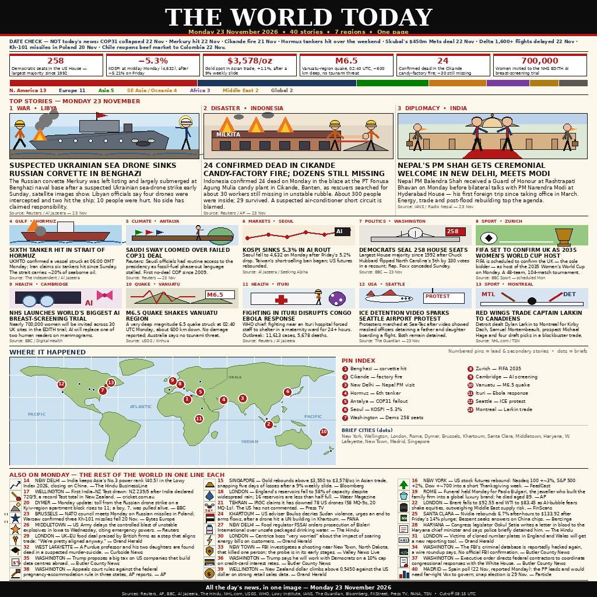

# THE WORLD TODAY — Monday 23 November 2026

## What's on the page

All of Monday 23 November 2026's news, in one image — **40 sourced stories across 7 regions**, every story pictured:

- **Top stories (3 illustrated lead scenes, drawn with code):** a suspected Ukrainian sea drone leaves the Russian corvette *Merkury* listing at Benghazi; Indonesia confirms 24 dead in the Cikande candy-factory fire with dozens still missing; Nepal PM Balendra Shah receives a ceremonial welcome in New Delhi and meets PM Modi. The lead scenes use fixed stickman characters — negotiator (tie), rescuer (helmet), sailor (cap), delegate (briefcase) — acting out each story beat.
- **Secondary stories (10 drawn mini-scenes):** the sixth tanker hit in the Strait of Hormuz; Saudi sway over the failed COP31 deal; the KOSPI's 5.3% slide; Democrats sealing 258 House seats; FIFA scheduled to confirm the UK as 2035 Women's World Cup host; the NHS's 700,000-woman AI breast-screening trial; the M6.5 Vanuatu quake; fighting disrupting the Ebola response in Ituri; the ICE detention protest at Sea-Tac; and the Red Wings trading captain Dylan Larkin to the Canadiens.
- **Also on Monday (27 briefs, each with its own drawn glyph):** India holding Asia's No.3 power rank, gold rebounding to $3,578/oz, the India–New Zealand Test draw, the Dymer toll update, the IRGC's drone claim, Brent at $92.55, the NATO council on Poland, Nvidia's rebound, and more.
- **Masthead statistics:** 258 Democratic House seats · −5.3% KOSPI · $3,578/oz gold · M6.5 Vanuatu quake · 24 dead in Cikande · 700,000 women in the EDITH trial — plus a region tally bar (N. America 13 · Europe 11 · Asia 5 · SE Asia/Oceania 4 · Africa 3 · Middle East 2 · Global 2).
- **WHERE IT HAPPENED:** a hand-plotted world map (equirectangular, equal x/y scale, graticule, ocean labels) with numbered pins for the 13 lead and secondary stories, a pin index, and dots for the brief cities.
- **DATE CHECK:** weekend news deliberately left out — the COP31 collapse (22 Nov), the *Merkury* strike (22 Nov), the Cikande fire (21 Nov), the Hormuz tanker hits (weekend), Skubal's $450m Mets deal (22 Nov), Delta's 1,600+ delayed flights (22 Nov), the Kh-101 missiles in Poland (20 Nov), and Chile reopening its beef market to Colombia (22 Nov) are all dated in the text; only Monday 23 November developments are reported as today's news. Attributions are kept exact throughout: "suspected" for the Benghazi strike, "claim IRGC" for the drone tally, "reportedly" for the FBI database report, and "scheduled to confirm" for FIFA.

## How it was made

- `generate.py` draws the whole 1024×1024 front page from scratch with Python + Pillow — no network, no external image assets. Every illustration, glyph, continent outline and pin is drawn by code.
- `main.py` copies the rendered `news.png` to the output location (`$MAKEFUN_OUTPUT_DIR/entry.png`, default `/output/entry.png`).
- The render is deterministic: rendering twice produces a byte-identical file (same SHA-256).
- Research cut-off: Monday 23 November 2026, 08:15 UTC. Stories were checked against named sources before use; the Chile–Colombia beef story (announced 22 Nov) was dropped from the story list and moved to the DATE CHECK box.

## Sources

Reuters, AP, BBC, Al Jazeera, The Hindu, IANS, Radio Nepal, The Guardian, NHL.com, TSN, USGS, Xinhua, WHO, Lowy Institute, Bloomberg, FXStreet, Press TV, PANA, Seeking Alpha, Digital Health, cricket.com.au, Water Magazine, FinScans, Bytes Europe, Particle, and others as credited on the page.
